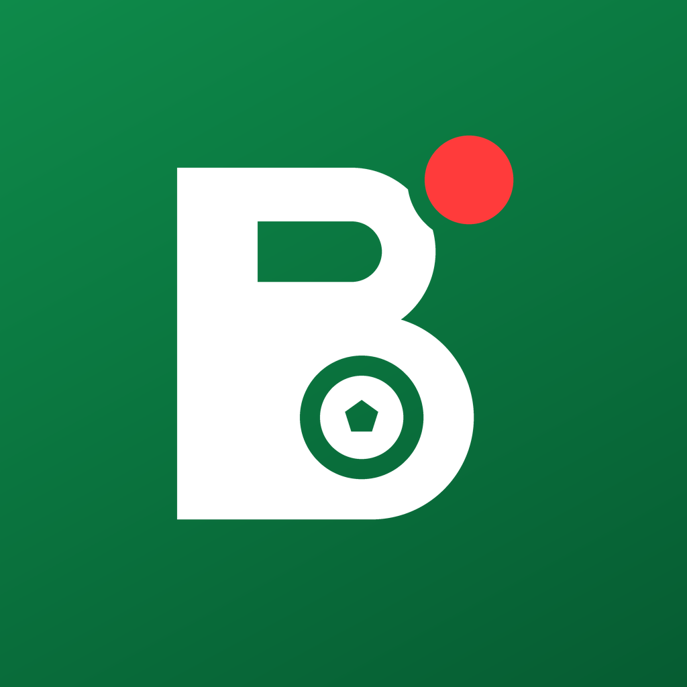

# BGoal brand

## Name

- **App name (under the icon):** BGoal
- **Store name:** BGoal - Live Sports Scores (fallback if a reviewer objects to "Sports" for a football-only app: BGoal - Live Football Scores)
- **Tagline:** Live scores. Goal alerts in seconds.
- Written **BGoal**: capital B, capital G, no space, in every language (Arabic text keeps the Latin name).

## Mark and icon

A white **B** whose lower loop holds a football, with a red **live dot** at its top right: the moment a goal alert lands.

All images are drawn from shapes by [app/tool/brand/make_icons.py](app/tool/brand/make_icons.py), so they can be regenerated or tweaked without design software. Files in `app/assets/brand/`:

| File | Use |
|---|---|
| `icon.png` | iOS app icon and source for every size (1024×1024, no transparency) |
| `icon_foreground.png`, `icon_monochrome.png` | Android adaptive icon and Android 13+ themed icon |
| `splash.png`, `splash_android12.png` | Launch screen |
| `play_store_icon_512.png` | Google Play listing icon |
| `play_feature_graphic.png` | Google Play feature graphic (1024×500) |
| `mark_green.png`, `mark_white.png` | The mark alone, for the app's welcome page, the website, social posts |
| `android/drawable-*/ic_notification.png` | Android status-bar notification icon (white silhouette) |

Keep clear space around the mark of at least the width of the live dot. Don't stretch it, recolour the B, or put club crests or league logos next to it in marketing.

## Colours

| Name | Hex | Use |
|---|---|---|
| BGoal green | `#0E8A4A` | Brand colour: icon background, splash, buttons. The app's Material 3 theme is generated from it (`lib/theme.dart`). |
| Deep green | `#065C32` | Gradient end in the icon and store graphics |
| Live red | `#FF3B3B` | The live dot. In the app, live minutes and red cards use their own accessible reds (`ScoreColors`). |
| Ink | `#081C12` | Dark text on light marketing images |
| White | `#FFFFFF` | The mark, text on green |

## Type

The app uses the phone's system font (Roboto on Android, San Francisco on iPhone), which keeps it fast and readable in Arabic, French and English. Marketing images (store screenshots captions, feature graphic) use a bold, slightly condensed sans; the feature graphic uses Bahnschrift. On the web, Barlow Condensed (Google Fonts, free) is a close match.

## Voice

Short, direct and calm, like a good stadium announcer: say what happened, then stop.

- "GOAL! Arsenal 2–1 Chelsea (Havertz 61')", not "Wow, what a goal!!"
- "Couldn't load matches. Check your connection.", not "Oops! Something went wrong 😢"
- Never betting language ("odds", "tips", "bet now"), in the app or the listings.
